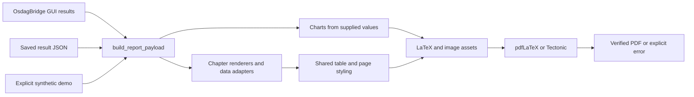

# What this project actually does

We are changing the report subsystem inside the real OsdagBridge source tree.
The starting point is `Nidhikhare12/OsdagBridge`, branch `dev`, commit
`d74f56dd7f22925fb8148cabf5740ed8d1e39ff3`. Its history, engineering modules,
desktop application and license remain in this repository. The Python launcher
and reporting-only distribution are convenient ways to exercise the same
report functions. They are not alternative engineering solvers.

OsdagBridge calculates bridge behavior and member design checks. A useful
design report must faithfully show those results, the selected inputs, the
check references and unavailable information. This work makes that reporting
step more reliable and easier to inspect.

## Follow one report through the code

1. In the desktop application, `OutputDock._on_report_clicked()` in
   `desktop/ui/docks/output_dock.py` opens the report workflow through
   `open_report_dialog()` in `desktop/ui/template_page.py`.
2. `PlateGirderBridge.generate_design_report()` in
   `core/bridge_types/plate_girder/plategirderbridge.py` passes its actual
   `input_dict` and `output_dict` to the report builder and supplies available
   figure images. The original GUI integration remains in place.
3. `build_report_payload()` in `core/reports/report_generator.py` validates and
   snapshots those dictionaries. It also retains inherited location and
   temperature enrichment. A preparation failure is recorded as an error,
   rather than silently becoming an apparently successful empty report.
4. `generate_report()` in that same file gathers the chapters, copies supplied
   image bytes/files, obtains quantities from the existing BOQ helper and asks
   `charts.generate_summary_charts()` to create chart PNGs.
5. `executive_summary.py`, `chap1.py` through `chap8.py`, and `chap9.py` render
   the document content. `chap9.references()` supplies the reference list.
   `data.py` reads structured girder check records for Chapter 5, preserving
   each member, load-case label, demand, capacity and backend status.
6. Each chapter uses `styles.styled_chapter()`. It applies a common layout,
   converts legacy tables to `longtable`, repeats headings, fits columns and
   replaces body multirow labels with repeated member labels across page
   boundaries. It marks empty body cells as N/A.
7. The orchestrator exports `.tex` and the matching image directory.
   `compilation.compile_latex()` runs the selected compiler without a shell,
   checks its exit status and requires a real PDF signature. pdfLaTeX runs twice
   for references; Tectonic manages its own reruns. Failed compilation retains
   the source and diagnostics and does not report an older PDF as new success.

The headless path starts at `run_report.py`, then
`core/reports/__main__.main()`. Its `load_report_data()` accepts a saved JSON
snapshot with `metadata`, `inputs` and `outputs`. `start.py` can prepare the
reporting environment before calling that path. `--demo` obtains data from
`demo.demonstration_data()` instead of running the analysis backend.

## Where the numbers come from

The most important distinction is between **an engineering result** and **its
presentation**. The designer in `core/bridge_types/plate_girder/designer.py`
produces per-member `CheckResult` records. Reporting reads those records from
`design_results.per_girder`, including their `checks` and `per_lc` entries.
Deck, cross-bracing and end-diaphragm results have separate backend dictionaries.
The reports must not borrow one component's values to make another look complete.

The report does perform limited arithmetic: demand/capacity ratios when needed,
numeric formatting, aggregation of the highest available ratio and some
read-only detail comparisons. It also calls the existing upstream quantity and
load helpers. Therefore, saying the report contains no calculations would be
inaccurate. [The engineering data audit](engineering_data_audit.md) separates
these operations from analysis and design.

The upstream DCR engine uses PASS below 0.90, WARN from 0.90 to below 1.00,
and FAIL at or above 1.00. Its supplied status is retained in the structured
check table. A chart line at UR = 1 is only a visual reference. It cannot
override a backend warning/failure or certify a design. Missing/invalid
capacities remain N/A. Conflicting supplied ratios are flagged, with tolerance
for the backend's rounding of operands and ratios.

## What was refactored

Previously, page rules and table formatting were scattered among chapters;
many tables had no useful continuation header. Some table widths ignored their
padding, footer positioning used negative offsets and multirow member labels
could extend through page breaks. These rules now come from `styles.py`.

The earlier detailed girder tables repeated flat controlling-girder fields
under every girder's label. The audit replaced those misleading duplicates
with actual structured member/check records. Legacy flat values are shown only
as explicitly unattributed reference values when structured checks are absent.
The obsolete duplicated girder rendering code was removed. The engineering
designer, analyser, code routines and quantity calculator were not changed.

The executive summary now uses a row per member, avoiding an ever-wider grid.
Its ratios come from the same validated sources as the chart and detailed
checks. Missing results, zero capacity and explicit failures remain distinct.
Missing drawings use compact unavailable notes; real supplied drawings are
embedded when present. No illustration is invented as a bridge drawing.

## Features and their practical limits

| Capability | What works | Limit |
| --- | --- | --- |
| Existing GUI integration | Same report entry points remain wired to the backend. | The complete GUI/CAD workflow has not been exercised here. |
| JSON and demo reporting | Source export and actual PDF compilation are exercised. | JSON consumes existing results; demo results are synthetic. |
| Repeating tables and common style | Real multipage row/header/footer regression tests pass. | Arbitrary real design content still needs visual review. |
| Vehicle/footway tables | Separate tables, units and actual saved selection flags. | Some force/vehicle-specific outputs are absent from upstream. |
| Utilization and material charts | Generated from separate, explicit sources with N/A support. | Charts are not independent engineering validation. |
| Quantity summary | Existing BOQ helper is called and its estimates are disclosed. | End-diaphragm mass is missing; rebar mass is an estimate. |
| Existing PDF inspection | Text, structure, encryption and optional row geometry checks. | Inspection does not recover engineering model data from a PDF. |
| Launch/distribution | One-command bootstrap, Windows launcher, ZIP and Docker runtime. | Python and first-run downloads are required for the source ZIP. |

## How to explain this in an interview

Start with: “I refactored the reporting layer of OsdagBridge, preserving its
engineering backend. I made table layout consistent, added result-driven
visual summaries, and made missing or conflicting data visible.”

Then demonstrate a failed check and an unavailable check. Show that changing
the supplied result changes the PDF, that report generation does not mutate
the original snapshot, and that compiler errors return a failure. Explain why
you preserve backend warning bands instead of treating every UR below one as a
passing design.

Be explicit about the evidence: automated rendering tests and synthetic PDFs
are working; a genuine full-GUI before/after design comparison remains a
submission gate. The [task audit](submission_audit.md) explains that gap.
